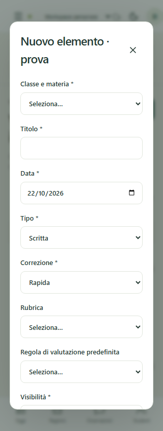
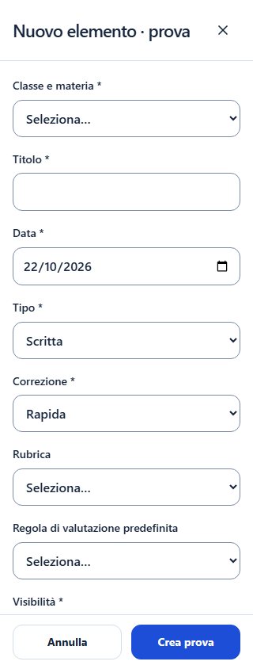

# Collaudo UX mobile — 22 ottobre 2026

## Interfaccia implementata

- Navigazione smartphone/tablet con cinque destinazioni Home, Classi, Registro rapido, Valutazioni e Altro; menu completo con focus confinato, Escape e ripristino del focus. Sidebar desktop conservata.
- Filtri di contesto richiudibili su smartphone; ordine Organizzazione invariato: Anni scolastici, Scuole, Materie, Classi, Classi / Materie, Assegnazioni docenti, Studenti, Iscrizioni.
- Tutti i 36 editor generici: fullscreen fino a 640 px, campi a colonna intera, intestazione e azioni indipendenti dallo scroll, safe area e adattamento a visualViewport. Conferma di abbandono per modifiche non salvate; input a 16 px, focus iniziale e ripristino. Validazione conserva nomi accessibili stabili anche dopo gli errori.
- Elenchi delle 36 risorse: schede mobile con campi principali, stato, apertura/modifica e dettagli/azioni secondarie espandibili; tabelle desktop. Ricerca e paginazione da 50 elementi, senza renderizzare contemporaneamente le due versioni. Import, riepiloghi, storico, statistiche e sincronizzazione conservano le colonne e mostrano etichette per cella su mobile.
- Registro rapido/osservazioni: ricerca nome/cognome, singolo studente su smartphone, precedente/successivo, scorciatoie descrittive senza voto, feedback e correzione dell'ultima osservazione senza creare un'altra riga. Editor dettagliato e modalità con voto conservati.
- Compiti: ricerca e navigazione studente, esiti grandi, contatori, selezione evidenziata, possibilità di correggere l'esito e ripristinare l'ultimo esercizio. Cache delle versioni appena salvate per evitare modifiche basate su una revisione precedente al refresh.
- Verifiche: un quesito/criterio alla volta su smartphone, precedente/successivo, visualizzazione completa opzionale, esiti Bene/Così così/Male/Non risposto, avanzamento e punteggi. Correzione analitica e rubriche restano disponibili. Riepilogo di studente, categoria, regola, voto, peso ed esclusione prima della conferma mobile. Le proposte e il voto canonico continuano a dipendere dal database.
- Tema centralizzato blu/neutro, variabili chiare/scure, focus visibile e controlli da almeno 44 px. L'icona originale già presente non viene modificata; aggiornato soltanto il colore di tema HTML/manifest.
- Protezione delle modifiche non salvate anche nelle impostazioni e nel voto inline, inclusi navigazione, cambio studente e cambio workspace. Logout, coda cifrata e sincronizzazione mantengono i flussi esistenti.

## Audit responsive riproducibile

`node scripts/audit-responsive.cjs after --assert` usa esclusivamente fixture fittizie locali, senza scritture, reset o cloud. Richiede stack locale avviato e `.env.test.local`/fixture già predisposti.

Per ognuna delle larghezze **320, 360, 375, 390, 430, 768, 1024 px**, altezza 844 px: 12 pagine principali, 36 elenchi e 36 editor di creazione, per **588 misurazioni**. Screenshot di Home, Organizzazione, Registro, Osservazioni e cinque editor: **63 prima e 63 dopo**, con report JSON in `.local-test/mobile-audit/{before,after}/` (ignorato da Git).

| Misura | Prima | Dopo |
| --- | ---: | ---: |
| Pagine con overflow orizzontale | 0 | 0 |
| Campi visibili sotto 140 px | 698 | 0 |
| Pulsanti/link visibili sotto 44 px per lato | 5844 | 0 |
| Dialoghi oltre i bordi orizzontali | 0 | 0 |

Sono conteggi di occorrenze sulle schermate, non elementi unici. L'assenza di overflow iniziale non garantiva leggibilità: i campi erano stretti e il salvataggio richiedeva lo scroll del modulo. Il test browser aggiunge una finestra 320×430 per simulare spazio verticale ridotto; non equivale a una tastiera iOS reale.

Confronto dell'editor verifica a 320 px, campi vuoti e nessun dato personale:

| Prima | Dopo |
| --- | --- |
|  |  |

## Verifiche funzionali e limiti

La suite browser copre login/logout, isolamento tra due workspace fittizi, selettore docente autorizzato, ordine Organizzazione, CRUD studenti e archiviazione/ripristino, import/export, compiti, verifiche rapide/analitiche/rubriche, bozza/conferma, offline e conflitti. I nuovi scenari mobile coprono menu/focus, sette larghezze in tema scuro con testo al 200%, validazione editor, footer a spazio ridotto, abbandono modifiche, schede CRUD, osservazioni con correzione, compiti con ripristino e verifica con riepilogo; creazione/modifica di anni, scuole, materie e classi.

Verificati anche inserimento, modifica e apertura dettaglio di lezioni, consegne e verifiche da smartphone. Il test Indietro controlla entrambe le scelte: mantenere la bozza o abbandonarla. La protezione viene registrata prima del listener del router, per impedire che la schermata venga smontata prima della conferma.

I controlli unitari includono gestione delle modifiche non salvate e dieci rapporti di contrasto dei token CSS effettivi: testo normale, testo secondario, blu e testo dei pulsanti almeno 4,5:1; bordi dei campi almeno 3:1, in entrambi i temi. L'audit responsive viene eseguito anche dalla CI frontend e fallisce per overflow, dialoghi fuori schermo, campi sotto 140 px o pulsanti/link sotto 44 px. Gli artefatti CI includono esclusivamente report Playwright e cartella audit con dati fittizi, mai le credenziali delle fixture.

Restano da verificare su dispositivi reali: tastiera e rotazione Safari iOS/Chrome Android, safe area con notch, VoiceOver/TalkBack, installazione/aggiornamento PWA e modalità standalone. Il test del testo al 200% cambia la dimensione radice, non riproduce tutte le impostazioni di zoom del sistema. Nessuna dichiarazione di certificazione WCAG o di copertura CRUD esaustiva per tutte le combinazioni dei 36 moduli.

## Database e rilascio

Esito locale finale: **41/41 test unitari**, **24/24 scenari E2E**, typecheck, PWA ottimizzata offline/aggiornamento, audit responsive 588/588 e build di produzione superati. Controllo dell'artefatto Pages e cinque guardie di configurazione superati. Resta il warning non bloccante preesistente sul chunk ExcelJS. Le verifiche pgTAP/SQL riportate nel precedente report backoffice non sono state rieseguite da questo intervento esclusivamente frontend.

Questo intervento non aggiunge migrazioni, non modifica RLS/RPC e non accede al cloud Supabase. Il frontend continua a usare solo URL e chiave pubblicabile; nessuna password reale o dato reale di studenti viene aggiunto.

La **migrazione 20** `20261022000400_workspace_teacher_directory.sql`, già presente nel precedente commit backoffice, resta **da approvare per il cloud**: consultare [BACKOFFICE_IDENTITY](BACKOFFICE_IDENTITY.md). Non pubblicare il selettore nuovo come operativo prima di quel deploy autorizzato. La PR dev→main include anche tale lavoro precedente e le icone originali.

Push su dev e aggiornamento della PR non pubblicano Pages: il workflow di produzione conserva il controllo esclusivo su main e l'ambiente github-pages. Nessun merge o deploy viene eseguito da questo intervento. Prima del rilascio: approvazione/deploy separato della migrazione 20, controlli CI verdi, prova sui dispositivi reali, poi approvazione del merge. Aggiornare la PWA soltanto dopo aver sincronizzato eventuali modifiche in coda.
